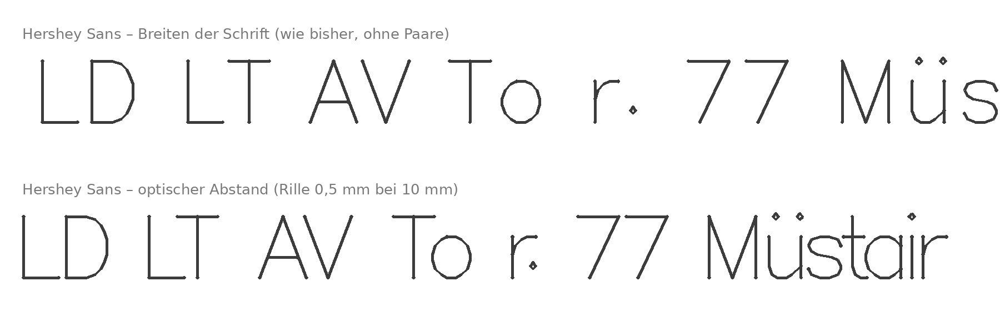

# Einlinienschriften mit optischem Abstand

Hirch CNC setzt Einlinienschriften (Single-Line-, Single-Stroke-, Mittellinien-Schriften) so, wie
sie gefräst aussehen: mit der Breite der Rille, nicht mit der dünnen gezeichneten Linie. Das gilt im
normalen Textwerkzeug. Man schreibt, ändert und richtet Text aus wie mit jeder Schrift, und die
Abstände stimmen ohne Nacharbeit.



## Das Problem

Fast alle Einlinienschriften setzen ihre Buchstaben schlecht, und das liegt nicht an einem
Hersteller. Es hat zwei Ursachen:

1. **Gezeichnet für eine hauchdünne Linie.** Die Abstände gelten für einen Plotterstift. Eine
   gefräste V-Rille oder Laserlinie ist 0,5–2 mm breit. Enge Stellen wachsen zu (der Fuss des **L**
   läuft in den Bauch des **D**), offene Stellen bleiben Löcher (**L T**, **T o**, **r .**). Keine
   Schrift kann das für alle Werkzeuge richtig haben, weil sie die Rillenbreite nicht kennt.
2. **Kaum Unterschneidung (Kerning).** Hershey kennt nur feste Breiten je Zeichen. Schriften anderer
   CAM-Programme bringen einige Paare mit, längst nicht alle, und auch die sind für die dünne Linie gedacht. Die
   Autoren von Relief SingleLine schreiben es ähnlich: Das Angebot an Einlinienschriften sei meist
   «irregular drawing quality, poor spacing, no kerning».

In anderen CAM-Programmen schiebt man darum Buchstaben von Hand zurecht.

## Das Verfahren

`hirch_cam/einlinien.py` (aus dem Prototyp «Frässchrift Studio»):

1. **Profil je Zeichen.** Jeder Strich wird mit dem Radius der Rille «aufgeblasen». In 64
   waagrechten Bändern von Unterlänge bis Oberlänge merkt sich das Profil den linken und rechten
   Rand dieser gefrästen Form.
2. **Abstand je Paar.** Zwei Zeichen werden so zusammengeschoben, dass die mittlere Lücke zwischen
   ihren gefrästen Formen über die Bänder der Versalhöhe einen festen Wert hat (Luft 22 % der
   Versalhöhe). Ränder, die weiter als 20 % der Versalhöhe zurückliegen, zählen nur bis dahin. So
   wird ein **T** über einem **o** nicht absurd eng. Dazu kommt ein Mindestabstand: In keinem Band
   kommen sich zwei Rillen näher als 35 % der Luft. Kein Strich läuft in den Nachbarn.
3. **Wortabstand** 25–42 % der Versalhöhe (aus der Breite des Leerzeichens der Schrift).

Der Dialog «Gravurtext» rechnet so mit der eingestellten Fräserbreite. Für das **Textwerkzeug**
(`hirch_cam/schrift_ttf.py`) wird daraus eine TrueType-Schrift:

- **Striche hin und zurück.** TrueType kennt nur geschlossene Umrisse. Jeder Strich wird hin und
  zurück gefahren (Fläche null) und mit Kontur statt Füllung gezeichnet. Beim Rechnen führt
  `svg_lesen.einlinig` die Umrisse wieder auf einfache Linien zurück.
- **Versalhöhe = 1 Geviert.** Schriftgrösse 10 mm ergibt 10 mm hohe Grossbuchstaben.
- **Optischer Abstand als Metrik.** Jedes Zeichen bekommt als Vorschub seinen Abstand zu typischen
  Nachbarn (Median zu H n o O l x). Jedes Paar unter den gängigen Zeichen (ASCII, Latin-1,
  typografische Satzzeichen, €) bekommt als GPOS-Unterschneidung `kern` die Differenz zum optischen
  Abstand. Das sind rund 30 000 Paare je Schrift, numpy rechnet sie in unter einer Sekunde.
  Leerzeichen-Paare setzen Wortanfang und -ende. Das Kerning der Vorlage wird ersetzt.
- **Bezug für die Rille.** Kerning wächst mit der Schriftgrösse, ein Fräser nicht. Die TTF rechnet
  mit einer Rille von 5 % der Versalhöhe (0,5 mm bei 10 mm Schrift).
- **Zuschlag für die wirkliche Rille.** Wird die Rille um einen Betrag breiter, braucht jedes
  Buchstabenpaar genau diesen Betrag mehr Abstand, und zwar bei allen Paaren gleich (Profil links und
  rechts je um die halbe Differenz breiter, die Mindestlücke ebenso). Hirch CNC setzt darum je
  Einlinientext mit einer Gravur einen Zuschlag = Rillenbreite − 5 % der Schrifthöhe als Zeichenabstand
  (`hirch-rille.cpp`, Attribut `hirch:zuschlag`). Die Rillenbreite kommt aus Werkzeug und Tiefe
  (V-Fräser: 2 × Tiefe × tan(Winkel/2) + Spitze). Das Feld «Abstand» des Textwerkzeugs zeigt nur die eigene
  Korrektur in mm, daneben steht grau «+ 0,65 für die Rille». Gesetzt wird der Zuschlag, wenn der
  Text eine Bearbeitung bekommt oder Grösse, Werkzeug oder Tiefe ändern, nie mitten im Schreiben.
- **Rille sichtbar.** Jede Linie mit einer Gravur zeigt die Zeichenfläche so breit, wie sie gefräst
  wird (halbtransparent in der Farbe der Bearbeitung, nur auf dem Bildschirm).
- **Gleiches Ergebnis wie der Gravurtext.** HarfBuzz (Inkscape, Pango) setzt mit dieser TTF auf
  ±0,03 mm genau wie der optische Abstand des Gravurtexts (`tests/test_schrift_optisch.py`).

## Die Schriften

Mitgeliefert werden nur Schriften mit eindeutig freier Lizenz (Herkunft und Lizenzen:
`hirch_cam/schriften/LIZENZEN.md`):

| Schrift | Lizenz | Zeichen |
|---|---|---|
| Hershey Sans, Sans Medium, Serif, Serif Italic, Serif Bold, Serif Bold Italic, Script, Script Medium, Gothic English | Hershey-Lizenz | 216 (inkl. Latin-1) |
| Hershey Gothic German, Gothic Italian | Hershey-Lizenz | ASCII; Umlaute zusammengesetzt; bei German ist «s» das lange ſ (Fraktur) |
| EMS Allure, Elfin, Felix, Nixish, Nixish Italic, Osmotron, Readability, Readability Italic, Tech | SIL OFL 1.1 | 216 |
| Relief SingleLine | SIL OFL 1.1 | 423 |
| KiCad Newstroke | GPL 2 oder später | 1337 (Latein, Griechisch, Pfeile, Mathe, ⌀) |

«Medium», «Bold» und «Bold Italic» bei Hershey sind Mehrstrichschriften: Breite Teile der
Buchstaben bestehen aus zwei oder drei parallelen Linien. Für den optischen Abstand zählen alle
Linien.

Eigene Schriften kommen über «Schrift importieren …» dazu (TTF/OTF, SVG-Schrift, Hershey `.jhf`, Zeichentafel).
Sie liegen nur in `~/.config/hirch-cam/schriften` und bekommen denselben optischen Abstand. Schriften mit
Herstellerlizenz kommen nie ins Repository.

## Selbst bauen (auch ohne Hirch CNC)

Die mitgelieferten Schriften sammeln (einmal, Ergebnis `hirch_cam/schriften/einlinien.json`):

```sh
Q=~/quellen; mkdir -p $Q && cd $Q
git clone --depth 1 https://github.com/isdat-type/Relief-SingleLine
git clone --depth 1 https://github.com/kamalmostafa/hershey-fonts
git clone --depth 1 --filter=blob:none --sparse https://github.com/KiCad/kicad-source-mirror kicad
(cd kicad && git sparse-checkout set --no-cone /common/newstroke_font.cpp) && cp kicad/common/newstroke_font.cpp .
ln -s /PFAD/ZUM/inkscape/share/extensions/svg_fonts svg_fonts
cd /PFAD/ZU/hirch-cam
PYTHONPATH=/PFAD/ZUM/inkscape/share/extensions python3 werkzeuge/einlinienschriften.py $Q
```

Alle Schriften als TTF mit optischem Abstand in einen Ordner schreiben, zum Beispiel für den eigenen
Plotter, Laser oder ein anderes Zeichenprogramm (braucht `python3-fonttools` und `python3-numpy`):

```sh
python3 -m hirch_cam.schrift_ttf --vorrat ~/.local/share/fonts/einlinien
```

Im Zeichenprogramm den Text **ohne Füllung, nur mit Kontur** zeichnen. Beim Umwandeln in Pfade
liegt jeder Strich doppelt (hin und zurück). Ein Fräs- oder Lasertool sollte ihn auf eine Linie
zurückführen, wie `hirch_cam/svg_lesen.einlinig`.

Das Paket von Hirch CNC baut die TTFs schon beim Packen (`fork/paket.sh`). Beim ersten Start werden
sie nur kopiert, nur importierte Schriften werden auf dem Rechner gebaut (etwa 1 s je Schrift).
